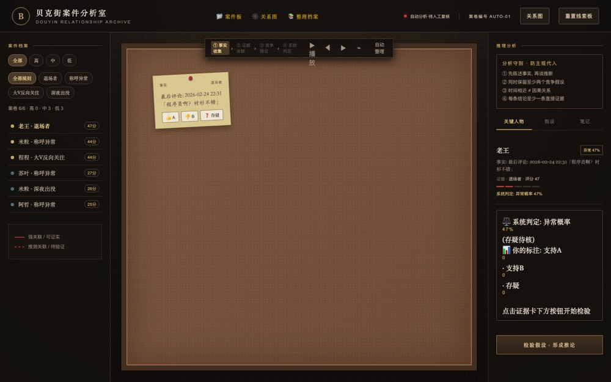
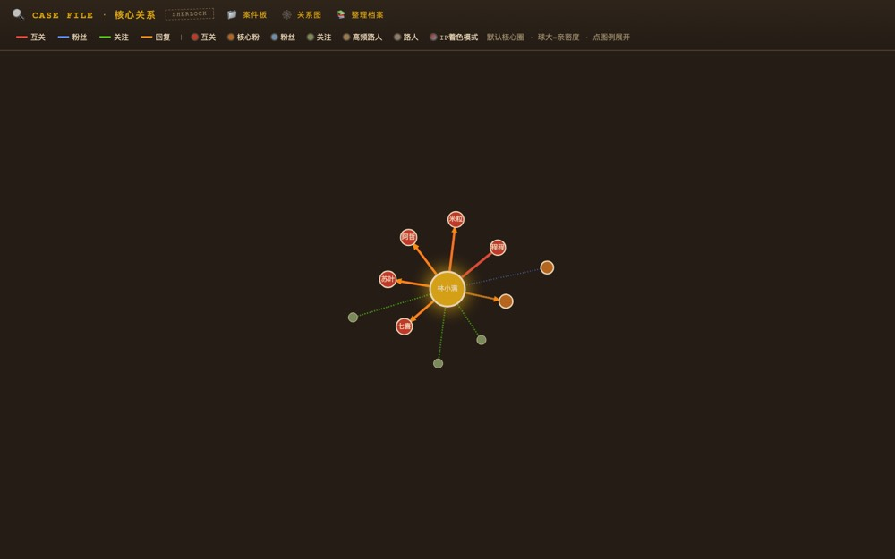
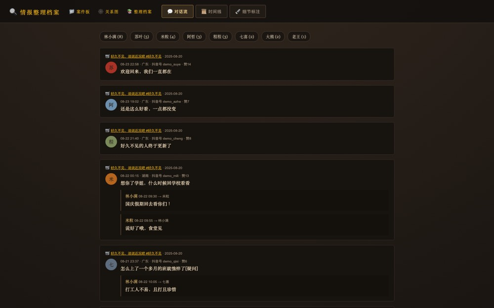

# 🔍 Sherlock · 抖音社交关系侦查工具

> 福尔摩斯式关系分析框架：从公开评论数据出发，交叉推演账号的社交关系网络、
> 人物画像、行为时间线与内容主题。

> ⚠️ **免责声明**：本仓库仅供学习与研究之用，禁止用于商业用途、
> 骚扰追踪或大规模爬取。仓库不包含任何真实用户数据，分析结论仅为
> 公开数据的统计推断。使用即表示同意全部条款，详见
> [DISCLAIMER.md](DISCLAIMER.md)。

## 研究背景

抖音公开评论区是一个信息密度极高的社交现场：评论、回复、关注关系、
IP 属地、时间戳、签名——这些公开数据交叉起来，足以勾勒出一个账号的
关系网络与行为轨迹。Sherlock 把这一过程工具化：

```
采集层(API) → 分析层(交叉推演) → 呈现层(线索墙可视化)
```

## 功能

| 模块 | 能力 |
|---|---|
| 采集 | 作品/评论/回复链/粉丝/关注，全部经抖音网页端 API 分页拉取 |
| 关系分析 | 粉丝∩评论者(核心粉)、互关、评论时段、IP 属地分布 |
| 人物档案 | 全员多维度画像：评论数/获赞/覆盖视频/活跃高峰/IP/签名 |
| 内容分析 | LDA 主题聚类 + SnowNLP 情感分布 |
| 线索墙 | G6 力导向关系图，图例开关，案件卷宗风格，单文件离线 HTML |

## 目录结构

```
sherlock/
├── sherlock.py          # 交互向导入口(登录→采集→报告→线索板)
├── sherlock/            # 核心包
│   ├── headless.py      # 无头反检测浏览器工厂(登录会话持久化)
│   ├── api.py           # 抖音网页端 API 封装(评论/回复/粉丝/作品,分页游标)
│   ├── collect.py       # 采集器 → data/data.json
│   ├── analyze.py       # 数据加载(兼容旧中文表头) + 关系/人物/主题 + 图数据
│   ├── suspects.py      # 8 条可疑点规则 + 评分
│   ├── timeline.py      # 时间线还原(视频锚点 + 评论旁证)
│   ├── report.py        # Markdown 侦查报告
│   ├── graph.py         # 福尔摩斯线索墙(G6 关系图)
│   ├── board.py         # 贝克街案件分析室(多案件推演板)
│   ├── web.py           # 网页侦查台(http://127.0.0.1:8787, 三步完成)
│   │
│   ├── reason.py        # [独立] 反证引擎 + 概率归一(方法论核心)
│   ├── predict.py       # [独立] 亲密度排名/退场风险/情绪周期
│   ├── explore.py       # [独立] 互关足迹交叉排查
│   ├── follows.py       # [独立] 关注方向归类
│   └── organize.py      # [独立] 情报整理档案(对话线程/时间线/高亮)
├── docs/                # 模板原型(贝克街案件分析室, board.py 已内置)
├── data/                # 活跃案数据(采集产物, 不入库)
├── data/cases/<name>/   # 归档案数据(按作者昵称)
├── analysis_output/     # 报告/线索墙/案件板产物(不入库)
├── browser_data*/       # 浏览器登录态(不入库)
└── config.json          # 可选: target_sec_uid / exclude_uids(由 config.example.json 复制)
```

## 快速开始

```bash
pip install -r requirements.txt
cp config.example.json config.json   # 填入目标 sec_uid 与排除名单(可选, 不入库)

# 向导入口(推荐): 扫码登录 → 粘贴主页链接 → 一键侦查
python sherlock.py
# 或一条命令: python sherlock.py auto <sec_uid>
# 配好 config.json 后可省略参数: python sherlock.py auto

# 网页侦查台: 本机 8787 端口, ①扫码 ②贴链接 ③开始侦查
python -m sherlock.web

# 分步命令行
python -m sherlock.collect <sec_uid>  # 采集(首次弹出浏览器扫码, 之后会话持久)
python -m sherlock.analyze            # 关系报告 + 人物档案 + 内容主题
python -m sherlock.graph              # analysis_output/福尔摩斯线索墙.html
```

登录说明：首次采集会弹出**可见浏览器窗口**扫码（会话持久化到
`browser_data_hd/`），之后的采集为无窗口后台运行。若目标账号的
粉丝/关注列表设了隐私（仅互关可见），需用有权限的账号重新扫码登录：
`python -m sherlock.collect <sec_uid> --profile browser_data_me --visible`
（用新 profile 走一遍扫码，互不影响既有会话）。

## 📸 界面预览

> 以下截图来自内置演示数据（虚构账号「林小满」），运行 `python sherlock.py demo` 即可重现。

**案件板**（五步推理链案卷）



**关系线索墙**（G6 力导向图，节点可点击跳转对话）



**情报整理**（对话线程 + 按人筛选）



## 🎬 30 秒演示（无需登录）

```bash
python sherlock.py demo
```

用内置**虚构数据集**（账号「林小满」，全部人物/评论均为虚构）跑完整流程，
一键生成全部产物到 `analysis_output/`（含 `cases/林小满/` 目录）。
看完后可用 `python sherlock.py` 菜单 [6] 切回真实案件。

## 🕹️ 操作方式（向导菜单）

```
python sherlock.py
  [1] 登录抖音           → 弹出浏览器扫码一次, 之后免登录
  [2] 采集线索           → 粘贴目标主页链接, 自动全量采集
  [3] 生成侦查报告       → 一键出全套 9 份(报告/线索墙/案件板/情报整理/
                            时间线/人物档案/内容分析/图JSON/案卷JSON)
  [4] 打开线索板         → 打开演示案卷板(demo_cases.json)
  [5] 网页入口           → 8787 网页侦查台(扫码+粘贴+一键侦查)
  [6] 切换案件           → 在 data/cases/<昵称>/ 之间切换数据集
  [7] 互关验证           → 亲密度 TOP 人物逐一查对方粉丝列表验证互关
  [q] 退出
```

**典型工作流**：新目标 → [1] 扫码 → [2] 采集 → [3] 出报告 → 浏览器里
点开 `analysis_output/` 下的页面（线索墙节点可点击跳转到该人物的对话）。
之后每天只需 [3] 一键重出；多目标用 [6] 切换。

## 独立命令行模块

以下模块不挂向导菜单，各自独立运行，属于侦查方法论的外延工具：

```bash
python -m sherlock.reason     # 反证引擎: 对可疑点逐一找反证并重算概率
python -m sherlock.predict    # 亲密度排名 / 退场风险 / 情绪周期
python -m sherlock.explore    # 互关网络的评论足迹交叉排查(需浏览器会话)
python -m sherlock.follows    # 关注列表 → 兴趣方向分布
python -m sherlock.organize   # 情报整理档案(对话线程 + 时间线 + 高亮)
```

## 关键技术点

- **API 优先**: 抖音 DOM 类名频繁变更，API 结构相对稳定；全部请求经
  浏览器登录会话 XHR 同步调用，规避签名逆向
- **翻页游标**: 粉丝/关注请求发 `max_time`，下一页游标取响应的
  `min_time`（拿响应的 `max_time` 会每页约 80% 重复）；网页端粉丝
  API 存在可见上限（平台限制，非 bug）
- **无头反检测**: `--headless=new` + 关闭 AutomationControlled + 真实
  UA；DrissionPage 4.1.x 的 `auto_port()` 会静默覆盖
  `set_user_data_path`（库 bug），须用 `set_local_port` 固定端口
- **数据卫生**: 采集按 sec_uid 去重；统一 JSON 落盘（data.json）；
  分页间隔 1s（限速）；分析层兼容旧版中文表头 CSV（存量数据迁移期）
- **隐私列表**: 粉丝/关注为空的采集会在结束时显式警告（目标列表
  可能仅互关可见，需换有权限的账号会话重采）

## 隐私与合规

- 工具只采集**公开可见**的评论与资料数据
- 仓库**不含任何真实用户数据**；`data/`、`analysis_output/`、
  `browser_data*` 均已在 `.gitignore` 排除
- 分析结论基于公开数据的统计推断，仅供研究参考，请勿用于骚扰、
  追踪或侵犯他人隐私；遵守平台条款，控制采集频率
- 完整声明见 [DISCLAIMER.md](DISCLAIMER.md)

## License

MIT
